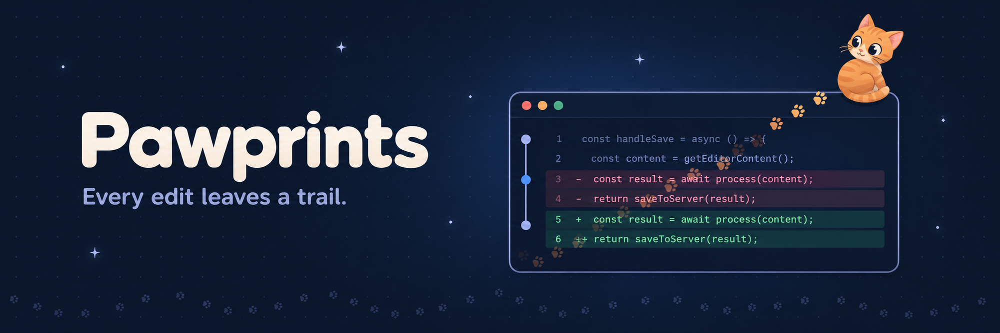

<p align="center">
  
</p>

Version history of every file Claude Code touches, viewable in VS Code, Cursor, or the terminal.

Claude Code edits files through tools. Pawprints hooks those tool calls, snapshots each file before and after, and keeps the history outside your repo. You then browse what Claude changed, diff any two versions, copy old content, or restore a file, from a sidebar in your editor or from a terminal UI.

It sees more than the edit tools: files changed by Bash commands (`sed`, heredocs, scripts, formatters), by MCP tools, by background commands, and by subagents, which get their own group under each prompt. Files outside the project and in git worktrees are recorded too. Changes you make yourself in the project between Claude's commands show as "outside Claude", never as Claude's, and undo leaves them alone. Work by your other Claude sessions stays with the session that did it.

Everything stays on your machine. No telemetry, no network calls except downloading the binary.

## Parts

| Part | What it is |
| :- | :- |
| `pawprints` binary (Go) | The engine. Runs as the Claude Code hook, as a CLI, and as a terminal UI. |
| Claude Code plugin | Installs the hooks and a `/pawprints` command. Lives in `plugin/`. |
| VS Code / Cursor extension | A sidebar over the same data. Thin client of the binary. Lives in `extension/`. |

## Install

Linux, x86_64:

```
curl -fsSL https://github.com/elythi0n/pawprints/releases/latest/download/install.sh | sh
```

That puts the binary in `~/.local/bin` and opens a short checklist:

```
 [x] Claude Code hooks           records Claude's edits   not set up
 [x] VS Code extension           code found               not set up
 [x] Cursor extension            cursor found             not set up
  ·  VSCodium extension          codium not found         not found
 [x] Shell completions           zsh                      not set up
```

Everything found on your machine starts ticked; `enter` sets it up. The binary carries the editor extension, so nothing else is downloaded. Reload the editor window afterwards to see the paw icon in the activity bar.

### Later

```
pawprints setup          # the checklist again: add an editor, update the extension, fix the hooks
pawprints doctor         # check git, hooks, the store, and Claude Code's session registry
```

The first launch of `pawprints` opens the checklist by itself, and so does the first launch after an update when an editor still has the older extension.

### Updating

Run the install line again. It fetches the newest release, and the checklist offers to update the editor extensions.

### The Claude Code plugin instead of settings.json hooks

```
/plugin marketplace add elythi0n/pawprints
/plugin install pawprints@pawprints
```

It adds a `/pawprints` skill and provides the hooks itself. If the hooks are also in `settings.json`, those step aside while the plugin is enabled, so nothing is recorded twice.

### By hand

Each [release](https://github.com/elythi0n/pawprints/releases) has the binary, the `.vsix`, and `checksums.txt`:

```
code --install-extension pawprints-<version>.vsix      # or: cursor --install-extension ...
```

Arch users can build a package from the repo with `makepkg -si`.

### Uninstalling

```
pawprints uninstall                         # remove the hooks from ~/.claude/settings.json
code --uninstall-extension elythion.pawprints
rm ~/.local/bin/pawprints
rm -rf ~/.pawprints                         # the recorded history, if you want it gone too
```

## Using it

```
pawprints                      # terminal UI: Live, Recent, Sessions, Files, Pins, Stats, Settings
pawprints log                  # newest edits first
pawprints sessions --live      # what Claude is doing right now
pawprints show <event>         # one edit with its diff
pawprints undo --turn          # revert what Claude did in the latest prompt (asks first)
pawprints export --session current > claude.patch
pawprints stats --daily
pawprints help                 # everything else
```

### Metrics and charts

```
pawprints ui                   # charts and history in the browser
pawprints metrics --all        # the same numbers in the terminal
```

`pawprints ui` opens a page on localhost with what Claude has been doing: token rate over time with spikes marked, lines changed, usage limits, what each session and project spent, and the most changed files. Every number can be narrowed by time range, project, and Claude account, and the Sessions and Files screens have the sidebar's history: every prompt, the files it changed, diffs, copy, pin, restore, and undo, each with a dry run first. It updates live while Claude works, and has light and dark themes. In the editor, **Pawprints: Open Metrics** shows the same page in a panel; in the terminal UI, `o` in the Stats pane opens it.

Costs are shown as **API cost**: what the tokens would cost at Anthropic's API prices, the figure `/cost` shows. On a subscription you don't pay it; it shows what the plan is worth. Usage limits are charted when [Whiskers](https://github.com/elythi0n/whiskers) is installed, since only the running Claude session knows them.

After updating from a version before metrics, run `pawprints usage backfill` once (or press **Fill in history** on the page) so older sessions get a timeline. It also fixes token totals older versions counted too high.

In the editor, the Pawprints sidebar shows the same: live sessions, every prompt with the files it changed (as a list or a folder tree, from the view's `…` menu), and one click to diff, restore, or undo.

In Claude Code, `/pawprints` loads a skill that teaches Claude the CLI, and a pasted `pawprints:<id>` reference resolves to that exact version.

## Themes

Pane 7 in the TUI previews themes live: Catppuccin Mocha and Latte, Tokyo Night, Dracula, EyeCandy, Ratatorks, Andromeda, Gruvbox, Nord, Rosé Pine, your terminal's own colors, and `auto`. Custom themes are JSON files of color roles or kitty `.conf` files in `~/.pawprints/themes/`:

```
pawprints theme import ~/.config/kitty/themes        # bring in terminal themes
pawprints theme new "My Theme" --from tokyo-night    # start one to edit
pawprints theme set my-theme
```

## Clearing history

```
pawprints clear --older-than 3m    # by age
pawprints clear --session <id>     # one session
pawprints clear --project          # this project
pawprints clear --all              # everything
```

Each prints what it would remove and asks first. The same options are behind `D` in the terminal UI and a command in the editor.
